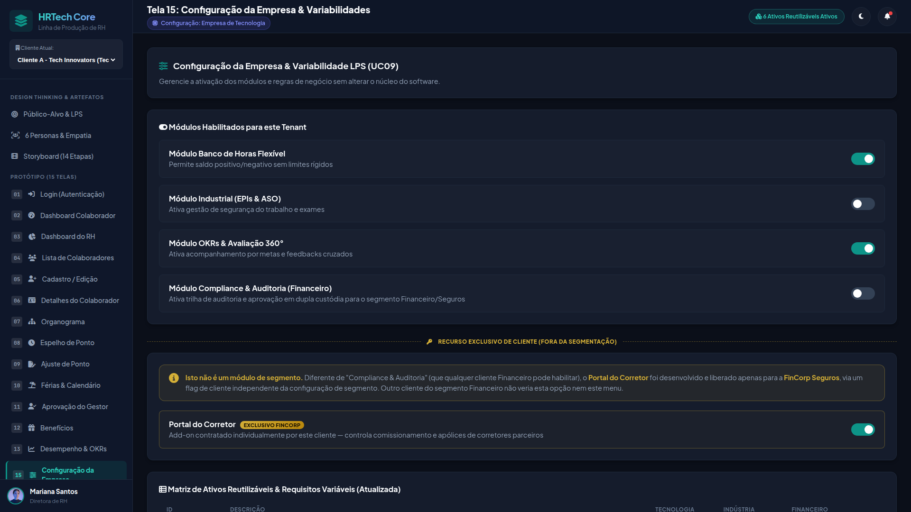
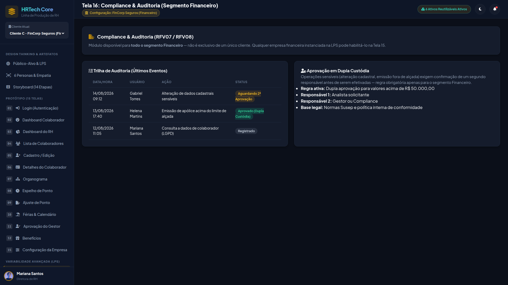
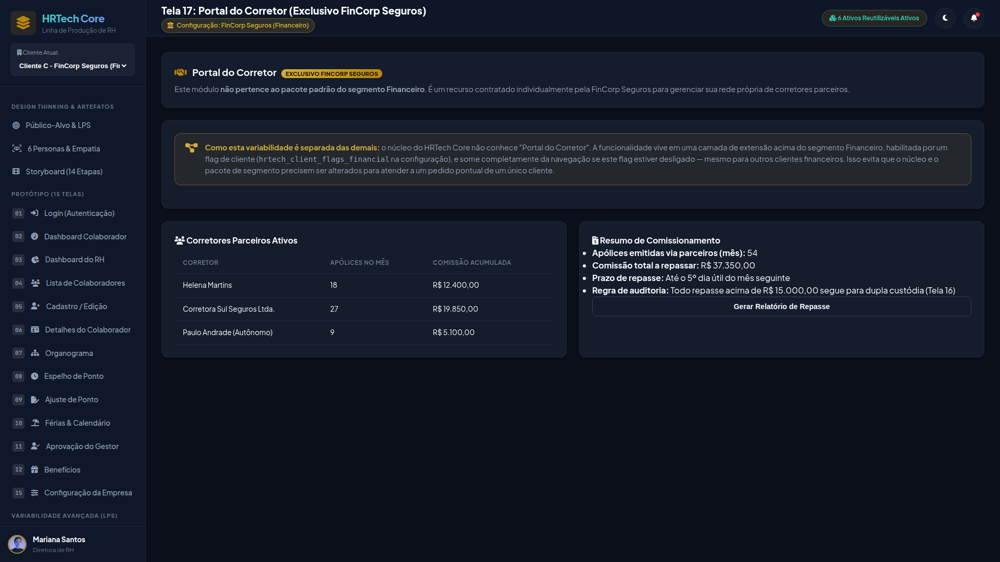

# PONTIFÍCIA UNIVERSIDADE CATÓLICA DO PARANÁ — PUCPR
## ESCOLA POLITÉCNICA — CURSO DE ENGENHARIA DE SOFTWARE
### DISCIPLINA: MEDIÇÃO E ANÁLISE DE SOFTWARE (2026-2)

---

# RELATÓRIO DE MEDIÇÃO: ANÁLISE DE PONTOS DE FUNÇÃO (APF)
### Entrega Individual — Metodologia IFPUG CPM 4.3.1 (*As-Built*)

**Aluno:** Fernando Lopes Duarte  
**Sistema:** HRTech Core — Plataforma de Gestão de RH e Linha de Produção de Software (LPS)  
**Módulos sob minha responsabilidade:** Administração Master Multi-Tenancy (CRUD 1), Trilha de Auditoria & Compliance LGPD/Bacen e Portal FinCorp de Seguros Corporativos (CRUD 10)  
**Tamanho Funcional:** **36 Pontos de Função Brutos (PFB)** | **44,28 Pontos de Função Ajustados (PFA)**

---

## 1. Contexto e Abordagem

Este trabalho adota a medição **As-Built**, que mensura estritamente as funcionalidades implementadas e operacionais no aplicativo entregue. Cada função catalogada possui correspondência direta em tabelas do banco SQLite (`hrtech_db.sqlite`), métodos nos controladores PHP (`app/Controllers/`) e telas com evidência visual.

### Tabela Resumo das Funções Individuais (36 PFB)

| Tipo | Função Real | Arquivo / Tabela | FTR / RLR | DER | Compl. | PFB | Tela |
| :---: | :--- | :--- | :---: | :---: | :---: | :---: | :--- |
| **ALI** | `ALI_TENANTS` | `tenants` | 1 RLR | 9 | Baixa | **7** | Tela 15 (Configuração Empresa) |
| **ALI** | `ALI_AUDIT_LOGS` | `audit_logs` | 1 RLR | 13 | Baixa | **7** | Tela 16 (Compliance LGPD) |
| **ALI** | `ALI_APOLICES` | `insurance_policies` | 1 RLR | 14 | Baixa | **7** | Tela 17 (Portal do Corretor) |
| **EE** | `EE_CRIA_TENANT` | `tenants` | 1 FTR | 5 | Baixa | **3** | Tela 15 (Modal de Criação) |
| **EE** | `EE_EXCL_TENANT` | `tenants` | 1 FTR | 2 | Baixa | **3** | Tela 15 (Botão Excluir) |
| **EE** | `EE_LOG_AUDIT` | `audit_logs` | 1 FTR | 4 | Baixa | **3** | Tela 16 (Modal de Evento) |
| **EE** | `EE_EMITE_APOLICE` | `insurance_policies` + `employees` | 2 FTR | 5 | Média | **4** | Tela 17 (Modal Nova Apólice) |
| **EE** | `EE_EXCL_APOLICE` | `insurance_policies` | 1 FTR | 2 | Baixa | **3** | Tela 17 (Botão Excluir) |
| **SE** | `SE_LAUDO_SHA256` | `audit_logs` | 1 FTR | 4 | Baixa | **4** | Tela 16 (Banner de Laudo) |
| **CE** | `CE_LISTA_TENANTS` | `tenants` | 1 FTR | 6 | Baixa | **3** | Tela 15 (Tabela de Empresas) |
| **TOTAL** | **10 Funções Implementadas** | — | — | — | — | **36** | **21 Dados + 15 Transações** |

---

## 2. Funções de Dados (21 PF)

### 2.1 ALI: `ALI_TENANTS` (7 PF — Baixa)
* **Objetivo:** Armazena as empresas clientes (tenants) da plataforma multi-tenant e seus respectivos segmentos da Linha de Produção de Software (LPS).
* **Tabela no Banco:** `tenants`
* **Registros Lógicos (1 RLR):** Dados cadastrais e parametrização de licença da organização.
* **Itens de Dados (9 DERs):** `id`, `cnpj`, `corporate_name`, `trading_name`, `segment`, `is_active`, `module_licenses`, `created_at`, `updated_at`.

### 2.2 ALI: `ALI_AUDIT_LOGS` (7 PF — Baixa)
* **Objetivo:** Armazena a trilha imutável de eventos de auditoria para atender aos requisitos de conformidade com LGPD e Bacen.
* **Tabela no Banco:** `audit_logs`
* **Registros Lógicos (1 RLR):** Eventos auditáveis com garantia de integridade e não-repúdio.
* **Itens de Dados (13 DERs):** `id`, `tenant_id`, `actor_user_id`, `action`, `entity_type`, `entity_id`, `previous_state`, `new_state`, `ip_address`, `user_agent`, `timestamp`, `previous_hash`, `integrity_hash`.

### 2.3 ALI: `ALI_APOLICES` (7 PF — Baixa)
* **Objetivo:** Mantém os contratos de apólices de seguro corporativo (D&O executivo e Vida em Grupo) emitidos no portal.
* **Tabela no Banco:** `insurance_policies`
* **Registros Lógicos (1 RLR):** Contratos de seguro vigentes e seus valores associados.
* **Itens de Dados (14 DERs):** `id`, `tenant_id`, `policy_number`, `broker_code`, `insurer_name`, `employee_id`, `insured_capital_cents`, `monthly_premium_cents`, `status`, `start_date`, `end_date`, `coverage_details`, `cancellation_reason`, `cancelled_at`.

---

## 3. Funções de Transação (15 PF)

### 3.1 Entradas Externas (EEs)
1. **`EE_CRIA_TENANT` (3 PF — Baixa):** Formulário de cadastro de nova empresa cliente e vínculo ao segmento LPS (`AdminController::createTenant`). Atualiza 1 ALI (`tenants`) com 5 DERs (`corporate_name`, `trading_name`, `cnpj`, `segment`, mensagem de retorno).
2. **`EE_EXCL_TENANT` (3 PF — Baixa):** Exclusão de organização contratante (`AdminController::deleteTenant`). Atualiza 1 ALI (`tenants`) com 2 DERs (`tenant_id`, mensagem de sucesso).
3. **`EE_LOG_AUDIT` (3 PF — Baixa):** Registro manual de evento e geração de hash SHA-256 no ledger (`ComplianceController::recordLog`). Atualiza 1 ALI (`audit_logs`) com 4 DERs (`action`, `entity_name`, `entity_id`, confirmação).
4. **`EE_EMITE_APOLICE` (4 PF — Média):** Emissão de seguro corporativo (`InsuranceController::issue`). Atualiza `insurance_policies` e valida dados de `employees` (2 FTRs) com 5 DERs (`policy_type`, `coverage_amount`, `monthly_premium`, `employee_id`, retorno).
5. **`EE_EXCL_APOLICE` (3 PF — Baixa):** Cancelamento e exclusão de contrato de seguro (`InsuranceController::delete`). Atualiza 1 ALI (`insurance_policies`) com 2 DERs (`id`, confirmação).

### 3.2 Saída Externa com Dado Derivado (SE)
* **`SE_LAUDO_SHA256` (4 PF — Baixa):** Emissão do laudo de conformidade criptográfica exibido no painel de auditoria.
* **Por que é um Dado Derivado?**  
  O diagnóstico apresentado (*"Cadeia Inviolável: 100% VÁLIDA"*) **não existe gravado em nenhuma tabela**. Ele é derivado matematicamente em tempo de execução: o algoritmo (`AuditLogger::verifyChainIntegrity`) itera registro por registro da tabela `audit_logs`, recalcula o hash criptográfico SHA-256 de cada bloco encadeado com o hash do bloco anterior e atesta se a cadeia permanece matematicamente intacta.  
  *Leitura:* 1 FTR (`audit_logs`) com 4 DERs de saída.

### 3.3 Consulta Externa com Entrada e Saída (CE)
* **`CE_LISTA_TENANTS` (3 PF — Baixa):** Visualização interativa da carteira de empresas cadastradas no ecossistema multi-tenant (`AdminController::index`).
* **Dados de Entrada (2 DERs):** Rota de requisição (`route=admin`) e Tenant da sessão (`active_role`).
* **Dados de Saída (6 DERs):** Código (`id`), Razão Social (`corporate_name`), Nome Fantasia (`trading_name`), CNPJ, Segmento LPS, Status Operacional.

---

## 4. Evidências Visuais (Telas da Aplicação)

### Evidência 1: Gestão de Empresas e Multi-Tenancy (Tela 15)
Comprova as funções `ALI_TENANTS`, `EE_CRIA_TENANT`, `EE_EXCL_TENANT` e `CE_LISTA_TENANTS`.

---

### Evidência 2: Compliance e Trilha de Auditoria LGPD/Bacen (Tela 16)
Comprova as funções `ALI_AUDIT_LOGS`, `EE_LOG_AUDIT` e a Saída Externa `SE_LAUDO_SHA256` (visível no banner superior de verificação de integridade).

---

### Evidência 3: Portal do Corretor FinCorp de Seguros (Tela 17)
Comprova as funções `ALI_APOLICES`, `EE_EMITE_APOLICE` e `EE_EXCL_APOLICE`.

---

## 5. Memória de Cálculo, Esforço e Custo

### 5.1 Fator de Ajuste (FA)
* **Nível de Influência Geral (NI):** 58 pontos (avaliado nas 14 Características Gerais do Sistema — GSC).
* **Fórmula IFPUG:** $\text{FA} = 0,65 + (0,01 \times \text{NI}) = 0,65 + (0,01 \times 58) = \mathbf{1,23}$
* **Pontos de Função Ajustados (PFA):**
  $$\text{PFA} = \text{PFB} \times \text{FA} = 36 \times 1,23 = \mathbf{44,28\text{ PFA}}$$

### 5.2 Esforço, Prazo e Custo
Adotando os parâmetros padronizados de mercado e da disciplina:
* **Taxa de Produtividade:** 9,58 horas por PFA.
* **Custo por Hora Técnica:** R$ 50,00 / hora.
* **Jornada de Trabalho Mensal:** 160 horas úteis.

| Métrica de Gestão | Fórmula Aplicada | Resultado |
| :--- | :--- | :---: |
| **Esforço em Desenvolvimento** | $\text{PFA} \times 9,58\text{ h/PFA}$ | **424,20 horas** |
| **Prazo Estimado (Dedicação Solo)** | $\text{Horas} / 160\text{ h/mês}$ | **2,65 meses (10,6 semanas)** |
| **Prazo via Equação de Cronograma** | $2,5 \times (\text{Horas})^{0,32}$ | **2,70 meses (17,25 semanas)** |
| **Custo Financeiro Estimado** | $\text{Horas} \times \text{R\$\ 50,00}$ | **R$ 21.210,12** |

---

## 6. Conclusão

A presente medição de **36 PFB (44,28 PFA)** atesta a completude das atribuições de Fernando Lopes Duarte na plataforma HRTech Core. A especificação apresenta aderência estrita à norma IFPUG CPM 4.3.1, garantindo que toda funcionalidade documentada possui respaldo funcional em banco de dados, controladores de negócio e interface com usuário.
